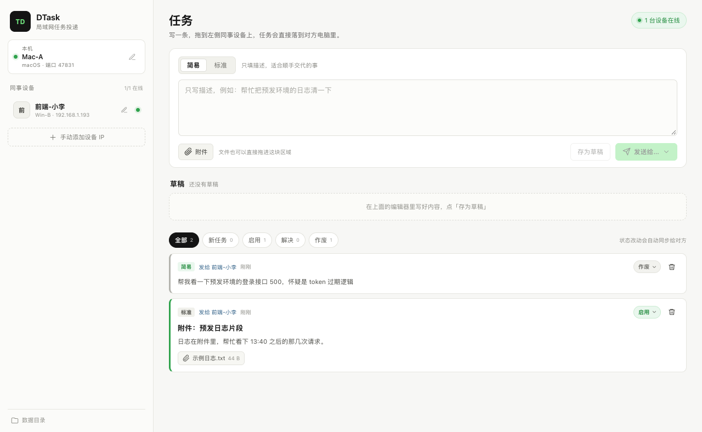

# DTask

局域网里的“任务空投”：写好一条任务，直接拖到左侧同事的电脑上，任务就落到对方机器里。不需要服务器、不需要账号、不经过云端。

仓库：<https://github.com/SwingQui/DTask>



## 已实现

- **设备自动发现**：同一局域网内自动出现，显示设备名、IP、在线状态
- **设备备注**：默认显示对方设备名；点铅笔可改成“前端-小李”这类本地备注，只影响自己这边
- **两种编辑模式**
  - 简易：只写描述
  - 标准：标题 + 描述
  - 两种都可以先存成草稿
- **拖拽投递**：按住草稿卡片拖到左侧设备上松手即发送；也可以点「发送给…」选设备
- **任务状态**：启用 / 解决 / 作废，任意一端修改都会同步到另一端
- **删除**：删除后对方设备上的同一条任务也会移除
- **附件**：随任务一起传；支持点「附件」选择，或把文件直接拖进编辑区
- **新任务提醒**：左侧设备未读数、卡片红点、系统通知、macOS Dock 角标
- **离线对账**：对方离线时发送会提示且保留草稿；对方重新上线后自动同步状态与删除
- **手动添加 IP**：组播被路由器拦截时，用 IP 直连兜底
- **本地存储**：所有任务和附件只存在各自电脑上

## 快速开始

仓库只含源码，开发需要 Node 22+。当前这台开发机把 Node 放在 `.tools/node`（不上传仓库），`scripts/dev.sh` 会优先使用它；换机器时先装 Node 22+ 即可。

```bash
./scripts/dev.sh          # 开发模式启动
./scripts/build-mac.sh    # 类型检查 + 构建 + 打 dmg
```

打包产物在 `dist/`：

- `DTask-0.1.0-arm64.dmg`（Apple Silicon Mac）
- `DTask Setup 0.1.0.exe`（Windows x64，已在 macOS 上交叉打包成功，但未在 Windows 实机运行过）

Intel Mac 需要单独出一份：

```bash
npx electron-builder --mac dmg --x64
```

Windows 安装包在 macOS/Linux 上也能直接打：

```bash
npm run dist:win
```

macOS 安装包未签名，首次打开请右键 → 打开，或：

```bash
xattr -dr com.apple.quarantine /Applications/DTask.app
```

Windows 安装包同样未签名，首次运行会遇到 SmartScreen 提示，选择「更多信息 → 仍要运行」。

> Windows 运行时尚未实机验证。路径、文件名清洗、防火墙提示都按 Windows 处理了，但正式发给同事前建议先找一台 Windows 跑一次双机联调。

## 两台电脑第一次怎么用

1. 两台电脑连同一个 Wi-Fi / 交换机，处于同一网段。
2. 各自打开 DTask。
   - macOS 首次会弹「本地网络」权限，必须允许。
   - Windows 首次会弹防火墙，勾选「专用网络」。
3. 左侧「同事设备」里出现对方，说明通了。
4. 右侧写内容 → 存为草稿 → 把草稿卡片拖到左侧设备上。
5. 对方收到红点与系统通知；点一下任务卡即标记已读。

找不到对方时，点左下角「手动添加设备 IP」，填对方地址：

- macOS 查 IP：`ipconfig getifaddr en0`
- Windows 查 IP：`ipconfig`（看 IPv4 地址）

默认端口 `47821`，被占用会自动顺延；发现服务用 UDP `47820` + 组播 `239.255.42.99`。

## 数据存在哪

- macOS：`~/Library/Application Support/DTask`
- Windows：`%APPDATA%\DTask`

里面有 `data.json`（设备、任务）和 `attachments/`（附件副本），其余是 Electron 的缓存目录，可以忽略。左下角「数据目录」可直接打开。退出软件后删掉整个目录即可清空。

## 已知限制

- **没有鉴权与加密**：同一局域网里任何装了 DTask 的电脑都能看到设备并投递任务。只适合可信的办公内网，不要在公共 Wi-Fi 使用。
- **依赖同一子网**：路由器开启 AP 隔离/客户端隔离时，自动发现会失效，手动 IP 也可能连不上。
- **状态冲突按更新时间覆盖**：两端系统时钟差太多时，可能以旧盖新。
- **附件没有进度条**：大文件接收期间会显示「接收中…」，完成后可点开。
- **离线不能投递**：对方离线时发送会报错，草稿会保留。
- **macOS 双实例已验证**；Windows 需要实机再跑一遍发现、投递、附件、重连。

## 开发与测试

```bash
npm run typecheck    # TypeScript 检查
npm run e2e          # 组播发现模式：两个实例跑完整链路
npm run e2e:manual   # 手动 IP 模式：隔离组播后再互加设备
npm run icon         # 重新生成应用图标
```

`npm run e2e` 会启动两个 DTask 实例（数据目录 `/tmp/dtask-e2e-a|b`，端口 47831/47832），自动验证：

1. 双向发现
2. 界面创建草稿
3. 拖拽投递
4. 改设备备注
5. 对方改状态后回传
6. 附件传输并落盘
7. 对方离线时改状态，重连后自动对账

`npm run e2e:manual` 额外验证：组播被隔离时用 IP 添加设备，首次投递后双方自动互加地址，状态仍能双向同步。

## 结构

```
src/main/       主进程：UDP 发现、HTTP 服务、任务存储、同步与附件
src/preload/    contextBridge 暴露给界面的 API
src/renderer/   React 界面
src/shared/     主进程与界面共用的类型
scripts/        开发、打包、E2E、图标脚本
build/icon.png  应用图标
```

同步模型很简单：每条任务有全局 UUID，两端各存一份；任何改动递增 `revision`、更新 `updatedAt`，推给对方或等上线后交换全量任务，按 `updatedAt + revision` 做最后写入优先。任务归属不绑定某一端，所以双方都能改状态。

## 后续可以加

- 团队口令 / 设备白名单（避免同网段其他团队看到）
- 托盘常驻与开机自启
- 附件进度条、断点续传
- 按设备筛选、全文搜索
- Windows CI 打包与签名